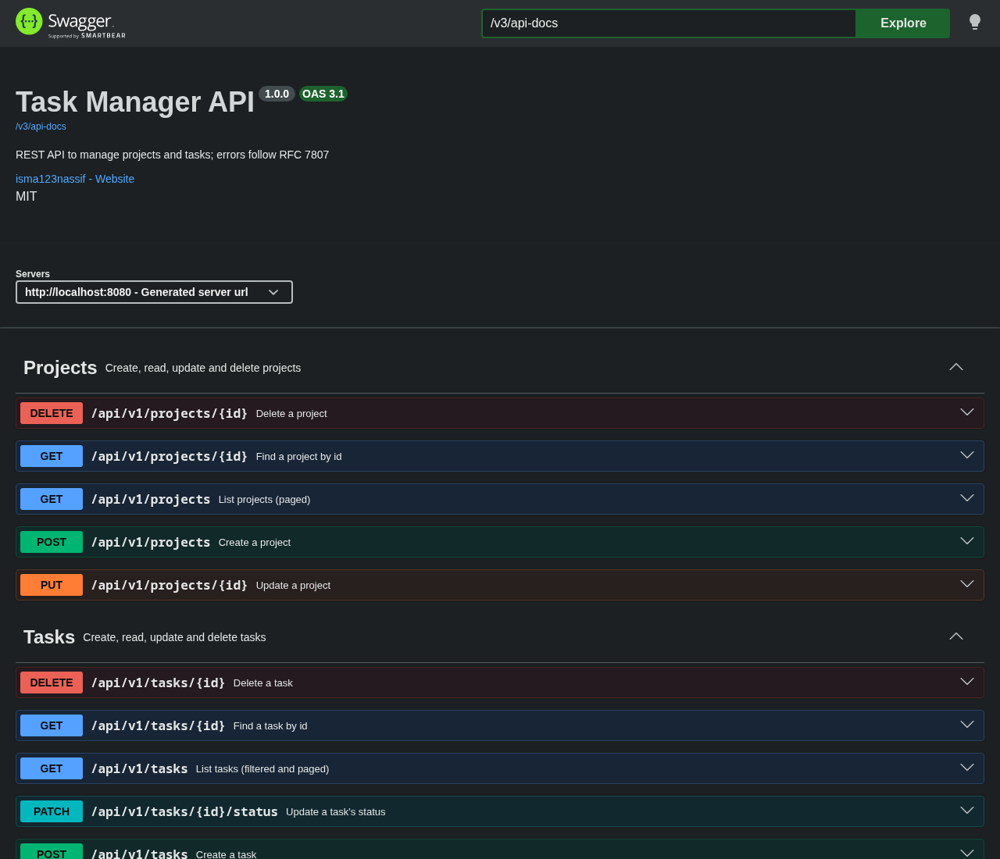
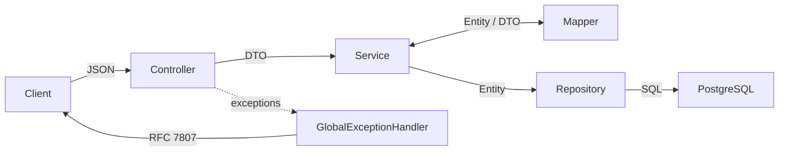
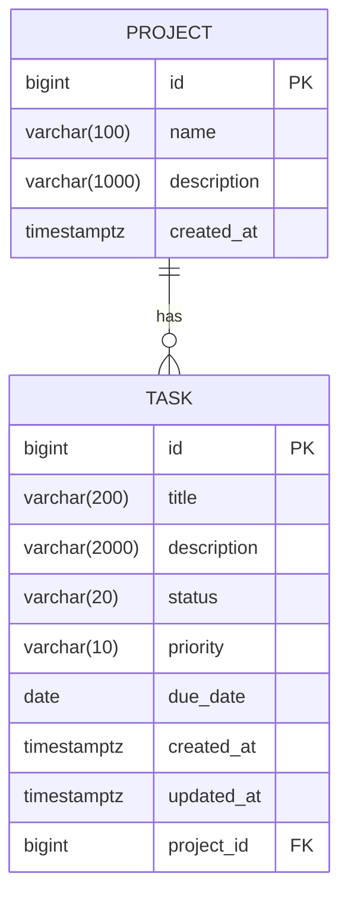

# Task Manager API

A production-style REST API for managing projects and tasks.

[](https://github.com/isma123nassif/task-manager-api/actions/workflows/ci.yml)
[](https://adoptium.net/)
[](https://spring.io/projects/spring-boot)
[](https://www.postgresql.org/)
[](LICENSE)

Built to showcase a clean layered architecture, database migrations with Flyway,
consistent RFC 7807 error handling, testing with Testcontainers and containerized
deployment with Docker.



## Quick start

```bash
git clone https://github.com/isma123nassif/task-manager-api.git
cd task-manager-api
docker compose up --build
```

Then open <http://localhost:8080/swagger-ui.html>.

### Run locally without Docker for the app

The `db` service in `docker-compose.yml` does not publish a port, so when running the
application outside Docker, start PostgreSQL manually:

```bash
docker run -d --name taskmanager-db \
  -p 5432:5432 \
  -e POSTGRES_DB=taskmanager \
  -e POSTGRES_PASSWORD=postgres \
  postgres:17
```

Then launch the application:

```bash
./mvnw spring-boot:run
```

The datasource is configured through environment variables:

| Variable     | Default                                        | Description          |
| ------------ | ---------------------------------------------- | -------------------- |
| `DB_URL`     | `jdbc:postgresql://localhost:5432/taskmanager` | JDBC connection URL  |
| `DB_USERNAME`| `postgres`                                     | Database user        |
| `DB_PASSWORD`| `postgres`                                     | Database password    |

## Features

- CRUD for projects and tasks.
- Filter tasks by `status`, `priority` and `projectId`, with pagination and sorting
  (JPA Specifications).
- Partial status update via `PATCH`.
- RFC 7807 `ProblemDetail` errors with per-field validation messages.
- i18n validation messages (English by default, honours the `Accept-Language` header).
- OpenAPI documentation with Swagger UI.
- Flyway database migrations.
- Health endpoint at `/actuator/health`.
- Docker multi-stage image running as a non-root user.
- CI with GitHub Actions.

## Tech stack

| Technology          | Version / Notes                                        |
| ------------------- | ------------------------------------------------------ |
| Java                | 21                                                     |
| Spring Boot         | 4.1 (Web MVC, Data JPA, Validation, Actuator)          |
| Hibernate           | 7                                                      |
| PostgreSQL          | 17                                                     |
| Flyway              | Database migrations                                    |
| springdoc-openapi   | 3                                                      |
| Lombok              | Boilerplate reduction                                  |
| JUnit 5 + Mockito   | Service and web-layer unit tests                       |
| Testcontainers      | Integration tests against a real PostgreSQL            |
| Docker / Compose    | Containerized build and local deployment               |
| GitHub Actions      | CI pipeline                                            |

## Architecture

Request flows from the controller through the service to the repository, with DTOs and
mappers on the boundaries and a single global exception handler translating failures
into RFC 7807 problem details.



Package layout:

```
src/main/java/com/isma/taskmanager
├── TaskManagerApiApplication.java   Application entry point
├── config/                          OpenAPI metadata (OpenApiConfig)
├── controller/                      REST endpoints (ProjectController, TaskController)
├── domain/                          JPA entities and enums (Project, Task, TaskStatus, TaskPriority)
├── dto/                             Request/response records (Java records)
├── exception/                       GlobalExceptionHandler and domain exceptions
├── mapper/                          Entity <-> DTO mapping (ProjectMapper, TaskMapper)
├── repository/                      Spring Data repositories and JPA Specifications
└── service/                         Business logic (ProjectService, TaskService)
```

Data model:



## API reference

| Method | Path                       | Description                              | Success |
| ------ | -------------------------- | ---------------------------------------- | ------- |
| POST   | `/api/v1/projects`         | Create a project                         | 201     |
| GET    | `/api/v1/projects/{id}`    | Find a project by id                     | 200     |
| GET    | `/api/v1/projects`         | List projects (paged)                    | 200     |
| PUT    | `/api/v1/projects/{id}`    | Update a project                         | 200     |
| DELETE | `/api/v1/projects/{id}`    | Delete a project                         | 204     |
| POST   | `/api/v1/tasks`            | Create a task                            | 201     |
| GET    | `/api/v1/tasks/{id}`       | Find a task by id                        | 200     |
| GET    | `/api/v1/tasks`            | List tasks (filtered and paged)          | 200     |
| PUT    | `/api/v1/tasks/{id}`       | Update a task                            | 200     |
| PATCH  | `/api/v1/tasks/{id}/status`| Update a task's status                   | 200     |
| DELETE | `/api/v1/tasks/{id}`       | Delete a task                            | 204     |

Query parameters for `GET /api/v1/tasks`:

| Parameter   | Allowed values                          | Default          |
| ----------- | --------------------------------------- | ---------------- |
| `status`    | `TODO`, `IN_PROGRESS`, `DONE`           | (none)           |
| `priority`  | `LOW`, `MEDIUM`, `HIGH`                 | (none)           |
| `projectId` | positive integer                        | (none)           |
| `page`      | integer                                 | `0`              |
| `size`      | integer                                 | `10`             |
| `sort`      | comma-separated `property,direction`    | `createdAt,desc` |

`GET /api/v1/projects` is paged the same way (via `page`, `size` and `sort`).

## Examples

Create a project:

```bash
curl -X POST http://localhost:8080/api/v1/projects \
  -H "Content-Type: application/json" \
  -d '{"name":"Web Panadería Martínez","description":"Online store for a family bakery"}'
```

Create a task:

```bash
curl -X POST http://localhost:8080/api/v1/tasks \
  -H "Content-Type: application/json" \
  -d '{"title":"Design home page","description":"Create the landing page mockup","status":"TODO","priority":"HIGH","projectId":1}'
```

Filter urgent pending tasks, sorted by due date:

```bash
curl "http://localhost:8080/api/v1/tasks?status=TODO&priority=HIGH&sort=dueDate,asc"
```

Update a task's status:

```bash
curl -X PATCH http://localhost:8080/api/v1/tasks/1/status \
  -H "Content-Type: application/json" \
  -d '{"status":"DONE"}'
```

Sample paged response:

```json
{
  "content": [
    {
      "id": 1,
      "title": "Design home page",
      "description": "Create the landing page mockup",
      "status": "TODO",
      "priority": "HIGH",
      "dueDate": "2026-11-10",
      "projectId": 1,
      "projectName": "Web Panadería Martínez",
      "createdAt": "2026-10-28T10:15:30Z",
      "updatedAt": "2026-10-28T10:15:30Z"
    }
  ],
  "page": 0,
  "size": 10,
  "totalElements": 1,
  "totalPages": 1
}
```

## Error handling

All errors are returned as RFC 7807 `ProblemDetail` responses with
`Content-Type: application/problem+json`.

Validation error:

```json
{
  "title": "Validation failed",
  "status": 400,
  "detail": "One or more fields are invalid",
  "instance": "/api/v1/tasks",
  "errors": {
    "title": "must not be blank",
    "projectId": "must not be null"
  }
}
```

Invalid enum value:

```json
{
  "title": "Malformed request body",
  "status": 400,
  "detail": "Invalid value 'URGENT' for field 'priority'. Allowed values: LOW, MEDIUM, HIGH",
  "instance": "/api/v1/tasks"
}
```

Status codes used:

| Code | Meaning                                                                |
| ---- | ---------------------------------------------------------------------- |
| 400  | Validation failure, malformed body, invalid enum, type mismatch, unknown sort property |
| 404  | Requested resource not found                                           |
| 405  | Method not allowed                                                     |
| 409  | Duplicate name or data integrity conflict                              |
| 500  | Unexpected server error                                                |

## Testing

```bash
./mvnw verify
```

Requires Docker, as integration tests use Testcontainers.

The test suite follows a pyramid:

- **Service unit tests** — `ProjectServiceTest`, `TaskServiceTest` use Mockito to verify
  business logic in isolation.
- **Web slice tests** — `ProjectControllerTest`, `TaskControllerTest`,
  `GlobalExceptionHandlerTest` use `@WebMvcTest` to exercise controllers and error
  handling without a database.
- **Integration tests** — `ProjectIntegrationTest`, `TaskIntegrationTest`,
  `OpenApiIntegrationTest` run against a real PostgreSQL started by Testcontainers.

36 tests in total.

## Design decisions

- **Case-insensitive unique project names** — a unique index on `LOWER(name)` enforces
  uniqueness at the database level, and `DataIntegrityViolationException` is mapped to
  a `409` response. This prevents concurrent duplicate inserts from surfacing as a `500`
  (a race condition that a simple application-level check cannot close on its own).
- **DTOs instead of JPA entities** — request and response payloads use Java records so
  the public API contract stays stable independently of the persistence model.
- **JPA Specifications for filtering** — dynamic `status`/`priority`/`projectId`
  filtering is composed with `Specification.allOf(...)` rather than one repository
  method per filter combination.
- **N+1 avoidance** — listing tasks uses `@EntityGraph(attributePaths = "project")` so
  the owning project is fetched in a single join instead of a query per task.
- **Schema owned by Flyway** — `spring.jpa.open-in-view=false` and
  `ddl-auto=validate` keep lazy loading out of the web layer and make Flyway the single
  source of truth for the schema.
- **Unknown sort properties return 400** — a `PropertyReferenceException` is caught and
  translated to a `400` instead of a `500`, while a catch-all handler logs the error and
  returns a generic `500` without leaking internals.
- **Deterministic validation language** — `spring.web.locale=en` makes validation
  messages default to English regardless of the server locale, while still honouring the
  `Accept-Language` header for i18n.
- **Production Docker image** — the build extracts a layered jar for cache-friendly
  builds, the runtime uses a JRE-only Alpine image, runs as a non-root user, and
  `exec java` keeps the JVM as PID 1 so it receives `SIGTERM` for graceful shutdown.

## Roadmap

- Authentication and authorization with Spring Security + JWT.
- Task assignees.
- Optimistic locking with `@Version`.
- Response caching.

## License

This project is licensed under the [MIT License](LICENSE).
